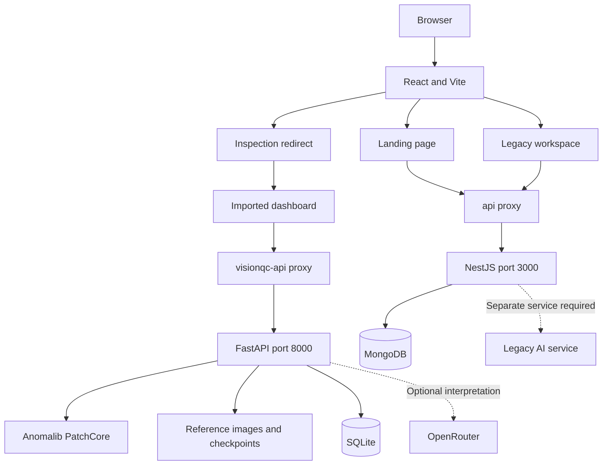

# VisionQC — Visual Quality Inspection

VisionQC is a visual inspection project for manufactured products, built for **Techforge Hackdeck 2026**. It combines a React landing page with a dashboard for reference-image management, PatchCore training, camera capture, anomaly heatmaps, and inspection history.

## Setup and installation

### Prerequisites

- Node.js **22.12+** and npm, or Node.js 20.19+ as supported by the installed Vite version.
- Python **3.11** for the commands below; the imported project recommends Python 3.10–3.12.
- Internet access for dependencies and initial pretrained model downloads.
- A webcam or USB camera for camera capture; uploads work without one.
- MongoDB only for the original NestJS backend and legacy workspace.

Commands below use PowerShell. Open each terminal at the repository root and keep the services running together.

### 1. Start the imported dashboard API

```powershell
cd VisionQC
py -3.11 -m venv .venv
.\.venv\Scripts\python.exe -m pip install -r backend/requirements.txt
if (!(Test-Path .env)) { Copy-Item .env.example .env }
.\.venv\Scripts\python.exe -m uvicorn app.main:app --app-dir backend --host 127.0.0.1 --port 8000
```

API: http://127.0.0.1:8000. Interactive documentation: http://127.0.0.1:8000/docs. Local data and model directories are created automatically.

### 2. Start the frontend

In another terminal:

```powershell
cd Frontend
npm ci
npm run dev
```

Open the URL printed by Vite, normally http://localhost:5173.

| Route | Purpose |
| --- | --- |
| `/` | Landing page |
| `/inspection` | Redirects to the imported dashboard |
| `/visionqc/` | Overview, Test mode, Reference library, and Settings |
| `/inspection/legacy` | Original inspection workspace |

The dashboard has its own HTML entry and original CSS. Its `/visionqc-api/*` requests are proxied to the Python API as `/api/*`. The main application's `/api/*` requests still go to NestJS on port 3000.

### 3. Optional: original backend and legacy workspace

The landing page's live data panels and legacy workspace use this backend. The imported dashboard can run independently.

```powershell
cd Backend
npm ci
npm run setup:local
```

This creates `Backend/.env` only if it does not already exist. Start a local MongoDB instance, or run the included development helper in another terminal:

```powershell
cd Backend
npm run mongo:dev
```

Then start the backend in another terminal:

```powershell
cd Backend
npm run dev
```

**Legacy AI dependency:** NestJS expects a separate service with `/health`, `/predict`, and `/model/*` endpoints. Its implementation is absent from the current repository. The imported FastAPI service has a different contract and cannot replace it directly. For full legacy functionality, provide a compatible service on a separate port and set `AI_SERVICE_URL` in `Backend/.env` accordingly. The example defaults to port 8000, already occupied by the imported API in this setup.

### Environment configuration

| File | Variable | Purpose |
| --- | --- | --- |
| `VisionQC/.env` | `OPENROUTER_API_KEY` | Optional server-side image-interpretation key |
| `VisionQC/.env` | `OPENROUTER_MODEL` | Example default: `typesafe/jev-router` |
| `VisionQC/.env` | `VISIONQC_DATA_DIR` | Optional reference-image and SQLite directory override |
| `VisionQC/.env` | `VISIONQC_MODEL_DIR` | Optional model and threshold directory override |
| `Backend/.env` | `PORT` | NestJS port; default 3000 |
| `Backend/.env` | `MONGODB_URI` | MongoDB connection string |
| `Backend/.env` | `AI_SERVICE_URL` | Separate compatible legacy AI service |
| `Backend/.env` | `AI_SERVICE_KEY` | Optional credential sent to that service |
| `Backend/.env` | `SUPERVISOR_TOKEN` | Required for legacy threshold updates |
| `Backend/.env` | `INSPECTION_TIMEZONE` | Daily statistics timezone; example uses Asia/Kolkata |

Keep credentials in environment files. Optional OpenRouter interpretation sends the selected image to the configured provider; its description does not change the score or verdict.

### Build and validation

From the repository root:

```powershell
cd Frontend
npm run build
npm test
npm run preview
```

If the environment blocks Vite's configuration bundling, use `npx tsc --noEmit` followed by `npx vite build --configLoader native`.

Python tests, from the repository root:

```powershell
cd VisionQC
.\.venv\Scripts\python.exe -m pytest backend/tests
```

Original backend checks, from the repository root:

```powershell
cd Backend
npm run build
npm test
```

For production, serve `Frontend/dist/visionqc/index.html` at `/visionqc/` before the main SPA fallback. Configure `/visionqc-api/*` to forward to the imported API as `/api/*`, and `/api/*` to NestJS if used. Vite's development and preview proxies do not configure a production web server.

## Key features

- **Image inspection:** upload a product image to obtain a score, verdict, and heatmap when a trained model is available.
- **Camera test mode:** select a camera, preview its feed, and capture individual frames.
- **Reference library:** upload or capture photos, assign Train/Validation/Test splits, update approval, and remove references.
- **PatchCore training:** learn normal visual patterns from approved good-product photographs.
- **Three-way triage:** configurable PASS, REVIEW, and FAIL score bands.
- **History and statistics:** local SQLite inspection records, rejection rate, and review counts.
- **Optional interpretation:** server-side OpenRouter visual descriptions.
- **Navigation integration:** Start Inspection opens the imported dashboard with both projects' CSS preserved.
- **Legacy workspace:** retained evaluation views, MongoDB logging, and supervisor controls when its services are available.

## Tech stack used

| Layer | Technologies |
| --- | --- |
| Frontend | React 19, TypeScript, Vite 7, React Router |
| Styling and UI | Tailwind CSS 4, custom CSS, Motion, Lucide React |
| Imported API | Python, FastAPI, Uvicorn, Pydantic, python-multipart |
| Machine learning | Anomalib 2.x, PatchCore, PyTorch through Anomalib |
| Image processing | Pillow, NumPy, Matplotlib |
| Imported storage | SQLite, local images, checkpoints, JSON metadata |
| Original backend | Node.js, NestJS 11, TypeScript, Mongoose, Multer |
| Original storage | MongoDB and a local inspection outbox |
| Optional interpretation | OpenRouter through HTTPX |
| Validation | Node.js test runner, pytest, TypeScript; ESLint configuration included |

## Architecture



The imported and original stacks use separate datasets, histories, thresholds, and API contracts. Navigation connects them; their stores are not synchronized.

```text
Techforge_Hackdeck_2026/
├── README.md
├── Frontend/
│   ├── src/                 # Landing page, routing, legacy workspace
│   ├── visionqc/            # Imported dashboard and original CSS
│   ├── public/              # Landing-page assets
│   ├── tests/               # Frontend tests
│   └── vite.config.js       # HTML entries and API proxies
├── Backend/
│   ├── src/                 # Original NestJS API
│   ├── scripts/             # Setup, MongoDB, smoke checks
│   └── test/                # Backend tests
└── VisionQC/
    ├── backend/app/         # FastAPI and PatchCore code
    ├── backend/tests/       # Python tests
    ├── backend/requirements.txt
    ├── .env.example
    ├── data/                # Generated references and SQLite database
    └── models/              # Generated datasets, checkpoints, thresholds
```

## Dataset and API information

### Dataset preparation

The imported workflow uses operator-supplied product photographs. No public benchmark dataset or accuracy claim is specified here. Landing-page artwork is not training data.

1. Open Reference library at `/visionqc/`.
2. Add **20–30 approved normal images** to Train. The current endpoint enforces both bounds.
3. Add at least one distinct normal image to Validation and one to Test; larger representative holdouts are recommended.
4. Include realistic lighting, orientation, and background variations. Keep duplicate or near-duplicate images out of different splits.
5. Select Train PatchCore. Only approved Train images enter the training dataset.
6. Assess thresholds on validation examples and reserve Test for final evaluation. The dashboard does not automate final benchmark evaluation.

Supported formats: JPG, JPEG, PNG, WEBP, and BMP. Maximum size: **15 MiB per image**. Reference uploads accept **1–100 files per request**. Camera captures use JPEG.

| Local path | Contents |
| --- | --- |
| `VisionQC/data/references/` | Reference images and metadata |
| `VisionQC/data/visionqc.sqlite3` | Inspection records |
| `VisionQC/models/dataset/train/good/` | Approved training photos |
| `VisionQC/models/dataset/validation/good/` | Normal validation photos |
| `VisionQC/models/dataset/test/good/` | Normal test photos |
| `VisionQC/models/training/` | Training outputs and checkpoints |
| `VisionQC/models/active.json` | Active model metadata |
| `VisionQC/models/thresholds.json` | Saved decision boundaries |

Data and model locations can be overridden using environment configuration.

### Decision rules

| Condition | Verdict |
| --- | --- |
| Score below `pass_below` | PASS |
| Score at or above `pass_below` and below `fail_at_or_above` | REVIEW |
| Score at or above `fail_at_or_above` | FAIL |
| No score because the model is untrained or inference fails | REVIEW |

Initial thresholds are **0.35** and **0.55**, pending local validation. The anomaly score is not a calibrated probability or confidence percentage. Rejection rate is FAIL count divided by all inspections; REVIEW remains separate.

### Imported API

Direct base: `http://127.0.0.1:8000/api`. From the frontend, replace `/api` with `/visionqc-api` to reach this service.

| Method | Direct endpoint | Purpose / inputs |
| --- | --- | --- |
| GET | `/api/health` | API, model, thresholds, provider status |
| GET | `/api/references` | List reference metadata |
| POST | `/api/references` | Multipart `files`, `split`, `approved` |
| PATCH | `/api/references/{id}` | Query parameters `split` and/or `approved` |
| GET | `/api/references/{id}/image` | Reference image |
| DELETE | `/api/references/{id}` | Remove reference |
| POST | `/api/train` | Validate splits and start background training; returns 202, or 409 if already running |
| GET | `/api/train` | Training status: idle, running, completed, or failed, with error details |
| POST | `/api/inspect` | Multipart `file` and optional `interpret` |
| PUT | `/api/thresholds` | JSON `pass_below`, `fail_at_or_above` |
| GET | `/api/inspections` | History; `limit` defaults to 50, bounded to 1–200 |
| GET | `/api/stats` | Totals, verdict counts, rejection rate |

PowerShell examples; replace the image path with a real file:

```powershell
curl.exe http://127.0.0.1:8000/api/health
curl.exe -X POST http://127.0.0.1:8000/api/inspect -F "file=@C:/path/to/product.jpg" -F "interpret=false"
```

### Original NestJS API

Base: `http://127.0.0.1:3000/api`; frontend proxy: `/api`. Currently accepts product identifier `product-001`.

| Method | Endpoint | Purpose |
| --- | --- | --- |
| GET | `/api/health` | Database and legacy AI health |
| POST | `/api/inspections` | Multipart `image`, `product_id`; JPEG/PNG up to 12 MiB |
| GET | `/api/inspections` | `product_id`, optional `prediction` and `page` |
| GET | `/api/inspections/today` | Daily statistics for `product_id` |
| GET | `/api/model/evaluation/{id}` | Forward evaluation request |
| GET | `/api/model/threshold/{id}` | Read legacy threshold |
| PUT | `/api/model/threshold/{id}` | Update using `x-supervisor-token` |
| GET | `/api/outputs/{id}/{kind}/{filename}` | Forward inspection and heatmap images |

## Screenshots

**Pending capture:** no connected browser was available when this README was created. Actual UI screenshots have not been added. Decorative assets are not application screenshots.

After starting the app, capture these views and save them in `docs/screenshots/`:

| Screenshot | View | Suggested filename |
| --- | --- | --- |
| Landing page | `/` — hero and Start Inspection | `landing.png` |
| Dashboard | `/visionqc/` — Overview | `dashboard.png` |
| Camera inspection | Test mode with live preview | `camera-test.png` |
| Dataset library | Reference library and split assignments | `reference-library.png` |
| Inspection result | Real verdict, score, and heatmap | `inspection-result.png` |
| Threshold settings | Settings and decision boundaries | `settings.png` |

Once files exist, embed them with Markdown:

```markdown

```

## Limitations

- Inspects individual images; conveyor controls, Arduino, LiDAR, and automatic rejection hardware are outside this implementation.
- A 20–30-image starter dataset does not establish production accuracy. Evaluate on representative held-out normal and defective samples.
- The imported dashboard preserves a Test split but does not automate final evaluation or threshold calibration.
- Lighting, background, camera angle, and product changes can affect scores. Default thresholds need validation.
- Machine-learning dependencies and pretrained weights are large. Hardware and downloads affect runtime; long operations may exceed the proxy timeout.
- Camera access requires browser permission and localhost or HTTPS.
- The imported API has no authentication or role-based access control. Public deployments require additional access controls.
- SQLite and MongoDB histories remain separate. Full legacy functionality needs a compatible AI service absent from this repository.
- Optional OpenRouter interpretation sends an image externally and depends on provider availability and output quality.

## Team members

- Aditya
- Prasham
- Prathamesh
- Atharva
